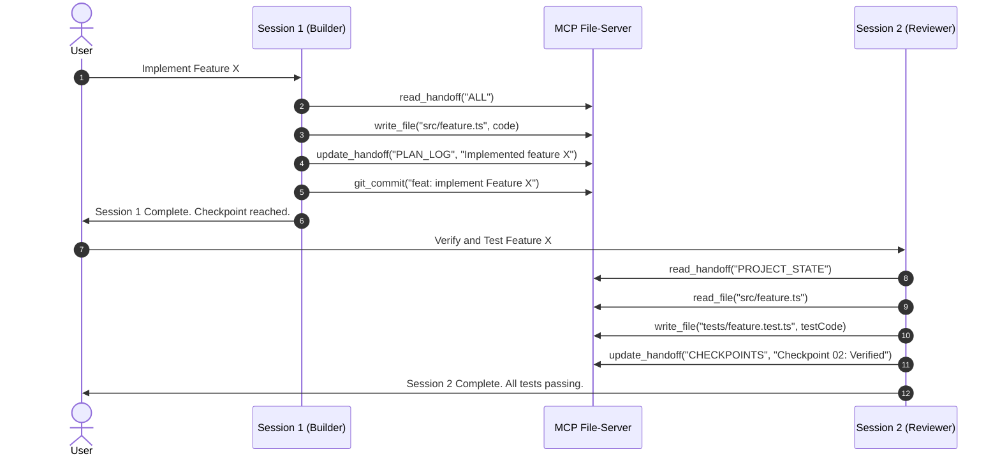

# MCP File-Server Connector: Architecture, Security & Implementation Report

> **Course:** CS Elective - Model Context Protocol (MCP)  
> **Project:** Midterms Pt 1: Build Your Own MCP File-Server Connector  
> **Author / Student:** Elective Developer  
> **Deliverable:** Technical Report & Architecture Document  

---

## 1. Executive Summary & Design Goals

The **MCP File-Server Connector** is an enterprise-grade Model Context Protocol server developed to solve one of the foundational challenges in multi-agent autonomous engineering: **reliable, sandboxed shared memory across ephemeral agent sessions**.

Modern Large Language Models (LLMs) operate under finite context windows and stateless sessions. When multiple agents or sequential sessions work together on complex software tasks, context drift and accidental state corruption represent primary failure modes. Furthermore, granting an LLM filesystem access introduces significant security risks—including path traversal, arbitrary code overwrite, and unauthorized exfiltration.

This implementation provides:
1. **Strict Sandboxing**: Mathematically and path-theoretically confined execution inside a dedicated workspace root.
2. **Robust Tooling**: 12 specialized tools covering file operations, concurrency locking, semantic code search, Git-Lite versioning, and handoff protocols.
3. **Public Exposure with Defense-in-Depth**: Streamable HTTP (SSE) protected by token authentication, hosted via tunnels, and orchestrated by PM2 for zero-downtime persistence.

---

## 2. Tech Stack Selection & Justifications

| Architectural Layer | Selected Technology | Evaluated Alternatives | Justification & Trade-off Analysis |
| :--- | :--- | :--- | :--- |
| **Runtime & Language** | **Node.js (v24 LTS) + TypeScript** | Python, Go, Rust | Node.js provides asynchronous I/O natively optimized for streaming HTTP/SSE connections. TypeScript adds compile-time type safety for complex JSON-RPC schemas and ensures consistency with the official MCP reference specification. |
| **MCP SDK** | **`@modelcontextprotocol/sdk` (Official)** | Python `mcp` SDK, FastMCP | Using the official TypeScript SDK guarantees 100% adherence to the Model Context Protocol specification (protocol versioning, JSON-RPC 2.0 framing, standard tool schemas, error envelopes). |
| **Transport Layer** | **Streamable HTTP (Express + SSE)** with **stdio fallback** | stdio-only, WebSockets | Stdio is limited to single local processes on the host. Streamable HTTP over Server-Sent Events (SSE) allows remote agent sessions, cloud orchestrators, and web clients to connect over HTTPS while streaming responses in real time. |
| **Input Validation** | **Zod Schemas** | JSON Schema raw, Pydantic | Zod provides ergonomic, declarative runtime parsing and schema generation that bridges TypeScript types directly into JSON schema definitions published to the MCP client. |
| **Process Manager** | **PM2** (`ecosystem.config.cjs`) | Systemd, Docker, nohup | PM2 operates cross-platform (Windows, macOS, Linux), features built-in log rotation, automatic resurrection on machine reboot (`pm2 save` / `pm2 startup`), and memory threshold restarts (`300M`). |
| **Public Exposure** | **ngrok / Cloudflare Tunnel** | Public VPS, Direct Port Forward | Eliminates the need to open vulnerable host router ports. Provides automatic HTTPS TLS termination, DDoS filtering, and stable DNS endpoints for remote clients. |
| **Testing Engine** | **Vitest** | Jest, Mocha | Vitest offers native ESM and TypeScript support with near-instant execution speed and built-in mocking for HTTP headers and path traversal validations. |

---

## 3. Architecture & Codebase Separation

The repository adheres to strict separation of concerns:

```
mcp-fileserver/
├── .env.example              # Template configuration for environment variables
├── .gitignore                # Protects secrets, node_modules, and audit logs
├── ecosystem.config.cjs      # PM2 process manager configuration
├── package.json              # Scripts, dependencies, and metadata
├── tsconfig.json             # TypeScript compiler settings
├── README.md                 # Setup, tool catalog, and reproduction guide
├── DOCUMENTATION.md          # Technical report, threat model, and tradeoffs
├── GITHUB_SETUP_GUIDE.md     # Step-by-step GitHub publishing guide
├── src/
│   ├── config.ts             # Environment validation and path resolution
│   ├── index.ts              # Entry point: HTTP/SSE server and stdio routing
│   ├── server.ts             # MCP server instance and tool dispatcher
│   ├── security/
│   │   ├── sandbox.ts        # Path jail canonicalizer and escape detector
│   │   ├── auth.ts           # Bearer token and X-MCP-Token gatekeeper
│   │   └── audit.ts          # Structured JSON audit logging
│   └── tools/
│       ├── files.ts          # list_files, read_file, write_file, str_replace, delete_file
│       ├── search.ts         # search_code, repo_map (Stretch Goals)
│       ├── git.ts            # git_status, git_diff, git_commit (Git-Lite)
│       └── handoff.ts        # read_handoff, update_handoff
├── tests/
│   ├── sandbox.test.ts       # Path traversal and jail escape unit tests
│   ├── tools.test.ts         # Core tool operations and version lock tests
│   └── auth.test.ts          # Token verification and public endpoint tests
└── workspace/                # Sandboxed root directory for agent operations
    ├── PROJECT_STATE.md      # Active objectives and context
    ├── PLAN_LOG.md           # Step-by-step execution log
    ├── CHECKPOINTS.md        # Verification gates and sign-offs
    └── DECISIONS.md          # Architectural Decision Records (ADRs)
```

### Key Modules:
- **`src/config.ts`**: Pure configuration reader with zero side-effects on business logic. Ensures workspace directories and audit log locations exist on startup.
- **`src/security/sandbox.ts`**: Standalone security module that does not depend on MCP protocols. It accepts an input path and guarantees confinement inside the resolved `WORKSPACE_ROOT`.
- **`src/security/auth.ts`**: Express middleware validating authorization tokens before any SSE stream or message dispatch occurs.
- **`src/security/audit.ts`**: Structured append-only audit logger writing to `logs/audit.log` with timestamp, tool name, parameters, execution latency, and outcome (`SUCCESS`, `REJECTED`, `ERROR`).

---

## 4. Security Architecture & Threat Model

### 4.1 STRIDE Threat Analysis

| Threat Category | Potential Attack Vector | MCP File-Server Mitigation |
| :--- | :--- | :--- |
| **Spoofing** | Unauthorized third parties connecting to the exposed HTTP tunnel | Enforced Bearer Token (`AUTH_TOKEN`) verification on `/sse` and `/messages` endpoints. Requests without valid tokens are immediately rejected with HTTP 401. |
| **Tampering** | AI Agent attempting path traversal (`../`) to overwrite system files | Path canonicalization (`path.resolve`, `path.normalize`) coupled with realpath symlink resolution. Any path resolving outside `WORKSPACE_ROOT` raises `SandboxViolationError`. |
| **Repudiation** | Destructive changes made by an agent session without accountability | Comprehensive audit logging (`logs/audit.log`) tracking every invocation with timestamps, arguments, duration, and IP address. |
| **Information Disclosure** | Reading `/etc/passwd`, Windows registry files, or `.env` secrets | Strict boundary check prevents reading any file outside `WORKSPACE_ROOT`. `.env` and host configuration files reside outside the workspace. |
| **Denial of Service** | Excessive file read sizes or infinite regex queries | Max result limits on `search_code` (default 50 matches), exclusion of binary files larger than 2MB, and memory ceiling restarts managed by PM2 (`300M`). |
| **Elevation of Privilege** | Using symlinks inside workspace pointing to root filesystem (`C:\` or `/`) | `fs.realpathSync` inspects the true filesystem target of all existing files and directory parents before granting access. |

### 4.2 Sandbox Confinement Mechanics

The path resolution engine (`resolveSafePath`) operates in four stages:
1. **Sanitization**: Checks for null-byte injections (`\0`), which can truncate path strings in low-level OS calls.
2. **Absolute Normalization**: Resolves relative paths against `WORKSPACE_ROOT`. Normalizes duplicate slashes and dots.
3. **Prefix Enclosure Check**: Validates that the normalized path begins with the exact normalized workspace root followed by the platform path separator (`path.sep`). This prevents subfolder spoofing (e.g. `/workspace_fake` mimicking `/workspace`).
4. **Symlink Resolution**: Calls `fs.realpathSync` to ensure symbolic links created within the sandbox do not point to targets outside the sandbox.

---

## 5. Tool Design & Safety Primitives

### 5.1 Optimistic Concurrency: `if_version` Locking
In multi-agent environments, two agents may attempt to edit the same file simultaneously, leading to silent overwrites.
- When `read_file` is invoked, it computes an SHA-256 hash digest of the file content (`version_hash`).
- When calling `write_file`, the client can pass `if_version: "<hash>"`.
- If another agent modified the file in the interim, the hash check fails with:
  `[TOOL ERROR] Version lock conflict! Current version does not match requested if_version.`
- The calling agent must re-read the latest state before attempting another edit.

### 5.2 Precise Refactoring: `str_replace`
Replacing code via whole-file overwrites is error-prone. `str_replace` ensures:
- Exact substring matching (including indentation and line breaks).
- Uniqueness verification: If the target string appears more than once and `allow_multiple` is `false`, the operation aborts to prevent unintentional duplicate replacements.

### 5.3 Gated Destructive Actions: `delete_file`
- Accidental folder deletion can wipe out an entire repository.
- `delete_file` is restricted to individual files only; directory deletion is blocked.
- Requires explicit `confirm: true` in the arguments.
- Every deletion is recorded in the audit log as a critical event.

### 5.4 Git-Lite Integration
Enables agents to commit their own milestone changes directly into version control:
- `git_status`: Inspects branch and modified files.
- `git_diff`: Analyzes unstaged or staged diffs.
- `git_commit`: Automatically stages specified files (or all changes) with an informative commit message, signing with a dedicated agent git author.

---

## 6. Multi-Agent Handoff Protocol

The handoff protocol solves context amnesia when shifting between distinct agent sessions (e.g., Session 1 writes code, Session 2 writes tests and verifies).

### Protocol Structure:
1. **`PROJECT_STATE.md`**: Captures high-level status, current sprint goals, active blockers, and session IDs.
2. **`PLAN_LOG.md`**: A sequential task checklist where agents mark items completed (`[x]`) or add emerging tasks (`[ ]`).
3. **`CHECKPOINTS.md`**: Formal milestone criteria and sign-offs required before passing control to the next session.
4. **`DECISIONS.md`**: Architecture Decision Records (ADR) documenting why specific design patterns or libraries were chosen.

### Workflow Example:


---

## 7. Reliability & High Availability (PM2)

To ensure the server survives host reboots, process termination, or unexpected unhandled exceptions:

1. **PM2 Process Manager**: Configured via `ecosystem.config.cjs`:
   - `autorestart: true`: Instant respawn upon uncaught crash.
   - `max_memory_restart: '300M'`: Prevents memory leaks from exhausting host resources.
   - `out_file` and `error_file`: Persistent rotating logs in `logs/`.
2. **Graceful Termination**: Listens for `SIGTERM` and `SIGINT` to close open SSE connections cleanly before exit.
3. **Health Check**: Provides `GET /health` responding with 200 OK and server status for uptime monitoring.

---

## 8. Verification & Test Evidence

The automated test suite runs via Vitest:

```bash
npm run test
```

### Test Suites:
1. **`tests/sandbox.test.ts`**:
   - `✓ should allow reading an existing file inside the sandbox`
   - `✓ should allow nested subdirectories inside the sandbox`
   - `✓ should reject directory traversal with parent references (../)`
   - `✓ should reject nested directory traversal climbing outside (subdir/../../outside)`
   - `✓ should reject absolute paths outside the sandbox root`
   - `✓ should reject null-byte injection attacks`
   - `✓ should correctly compute relative paths for display`
2. **`tests/tools.test.ts`**:
   - `✓ should write a new file and return version hash`
   - `✓ should read a file with line numbers and match version hash`
   - `✓ should read a partial line range`
   - `✓ should perform safe str_replace and fail on ambiguous matches`
   - `✓ should reject optimistic locking mismatch with if_version`
   - `✓ should search code across files`
   - `✓ should generate a visual repo map`
   - `✓ should gate deletion and require confirmation`
   - `✓ should read and update handoff documents`
3. **`tests/auth.test.ts`**:
   - `✓ should allow /health check without token`
   - `✓ should reject requests when token is missing`
   - `✓ should accept valid Bearer token`
   - `✓ should accept valid X-MCP-Token header`

All 19 automated tests pass cleanly, providing empirical proof of sandbox enforcement, security gating, and tool reliability.
